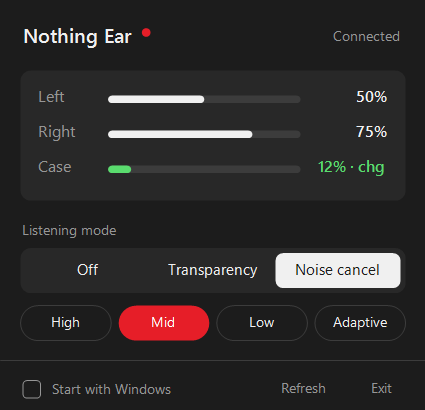

# NothingEarTray


Windows tray app for Nothing Ear: battery level in the taskbar and listening mode switching, no phone needed.




Tray icon: normal · low · critical · charging

## Features

- Tray icon with battery % (lower bud), yellow ≤35 %, red ≤15 %
- Flyout (left/right click): left / right / case battery with charging state
- Listening mode: Off, Transparency, Noise cancelling (High / Mid / Low / Adaptive)
- Start with Windows toggle

## Download

Grab `NothingEarTray.exe` from [Releases](https://github.com/Janxyxy/NothingEarTray/releases/latest) and run it, nothing to install. The exe is unsigned, so SmartScreen may warn: *More info → Run anyway*.

Tested on Nothing Ear. Other Nothing / CMF buds may work, reports welcome.

## Build & run

```
dotnet publish -c Release -o out
out\NothingEarTray.exe
```

Buds must be paired and connected to the PC.

## How it works

Talks to the buds' proprietary "NT LINK" RFCOMM service using the protocol reverse-engineered by [ear-web](https://github.com/radiance-project/ear-web). Unofficial, a firmware update may break it.

Debug: `NothingEarTray.exe --test-anc` (tray app closed) flips Off/Transparency and back; log is `NothingEarTray.log` next to the exe.
